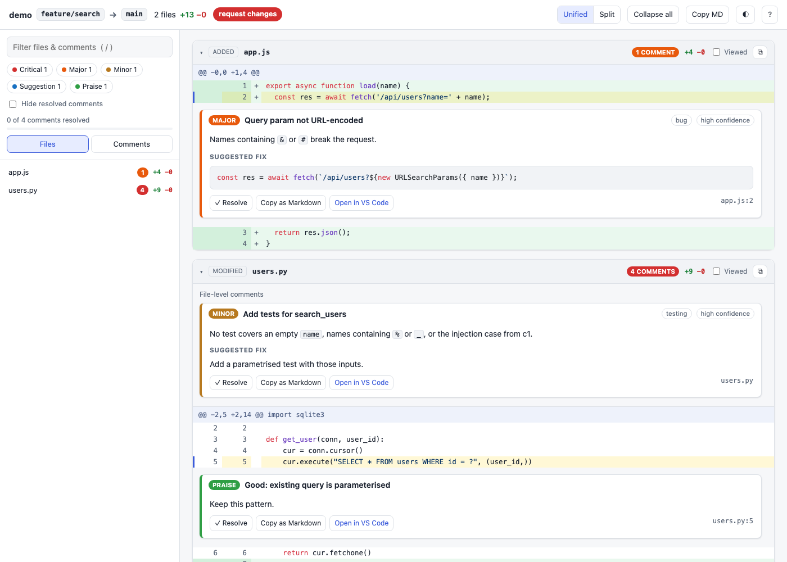
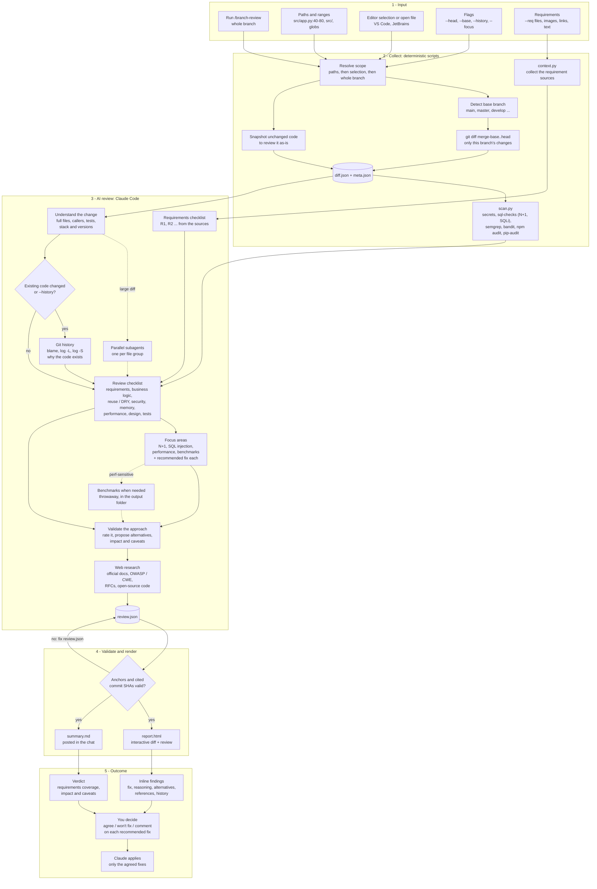
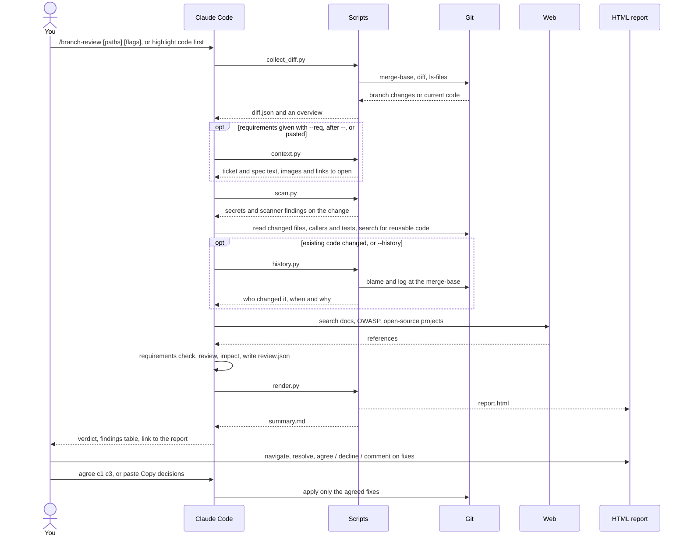
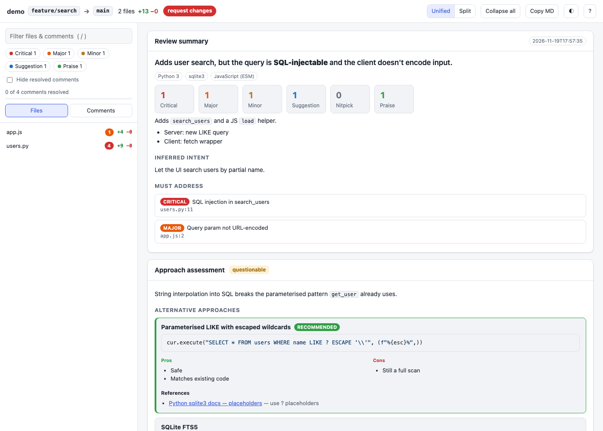

# claude-code-review: AI code review for Claude Code

[](https://github.com/rewin0087/claude-code-review#install)
[](https://github.com/rewin0087/claude-code-review/releases)
[](LICENSE)
[](https://rewin0087.github.io/claude-code-review/)

**`/branch-review` is an AI code review skill and plugin for [Claude Code](https://claude.com/claude-code).** It reviews **only the changes your git branch introduces**, or just the file, lines or editor selection you point it at, in **any tech stack**. It checks the code against **your requirements** (a ticket, spec, mockup, link or a few lines of text), validates the approach and business logic, finds **existing code to reuse**, runs **security and dependency scanners**, analyses **performance and memory** (with optional benchmarks), suggests better alternatives **backed by web references**, uses **git history** to see why existing code was written that way, and lists the **impact and caveats** of the change. It opens an **interactive HTML report** with every review comment shown on the diff line.

It runs on your existing Claude Code session, in the terminal, VS Code or JetBrains. You don't need an API key, server or CI setup.



## Features

- **Branch-only diff**: compares against the merge-base, so commits that landed on `main` after you branched are excluded. The base branch (`main`, `master`, `develop`, …) is detected automatically.
- **Review a file, a line range or your editor selection**: highlight code in VS Code and run `/branch-review`, or pass `src/app.py:40-80`, folders or globs. Unchanged code is reviewed as it is.
- **Any stack**: detects languages, frameworks and versions from the files and manifests, and fits its advice to the versions you use.
- **Review against requirements**: pass a ticket, spec, PDF, Word doc, mockup image, link or plain text with `--req` (or after ` -- `). It turns them into a numbered checklist and marks each item met, partial, missing or contradicted, with evidence lines. It also checks that the mandated tools, APIs and data formats are used, and used correctly.
- **Reuse and DRY**: searches the codebase for existing helpers, services and components that the change duplicates, and points to the code to reuse or extend.
- **Automated checks**: a built-in secret detector, plus semgrep, bandit, npm audit and pip-audit when installed. Findings on the changed lines are separated from pre-existing ones, and secrets are redacted.
- **N+1 queries, SQL injection, performance and benchmarks**: dedicated focus areas, always assessed, each with a status and a recommended fix. A built-in `sql-checks` scanner flags SQL built from strings and database calls inside loops.
- **You decide on every fix**: each finding has one recommended fix, marked required or optional, with its effort and why it's the best option. Click **Agree / Won't fix / Comment** in the report (or reply in the chat) and paste **Copy decisions** back. Claude only changes the code you agreed to.
- **Performance and memory**: static analysis of hot paths and a per-stack memory-leak checklist. When it matters, or with `--bench`, a throwaway benchmark runs in the output folder, never in your repo.
- **Impact and caveats**: breaking changes, caveats, things to consider, affected areas and a rollout plan.
- **Approach validation**: infers what the change is trying to do and rates the approach (sound / acceptable / questionable / flawed). It proposes alternative approaches with pros and cons and marks one as recommended.
- **Reasoned comments**: each comment has a severity, category, confidence, a concrete failure scenario, its reasoning, a suggested fix with code, and alternatives.
- **Web references**: every critical or major finding cites official docs, OWASP/CWE, RFCs or well-known open-source code. It may only cite links it actually opened, and its searches never include your code.
- **Git history ("why is it like this?")**: blames the lines your branch removes or rewrites and finds the commits that introduced them. It flags past fixes, reverts and workarounds, and warns when a change could bring an old bug back. Every cited commit SHA is checked against the repo.
- **Interactive report**: unified or side-by-side diff with **word-level highlighting** (the exact words added, removed or replaced inside a changed line stand out from the line colour), inline comments, a file/comment sidebar, severity filters, search, resolve/viewed tracking, an "Open in VS Code" link, commit links to GitHub/GitLab, keyboard navigation, dark mode, and "Copy as Markdown" for PR descriptions.
- **Results in the chat**: the verdict, the approach rating and a table of every finding, with a link to the report.
- **Large diffs**: split across parallel sub-agents.

## How it compares

Claude Code has its own **built-in `/code-review`**, and Anthropic's plugin marketplace has an official
**`code-review` plugin**. This skill used to be called `/code-review` too, which hid the built-in one,
so since 2.0.0 it's **`/branch-review`**. They work well side by side:

| | Built-in `/code-review` | Official `code-review` plugin | **`/branch-review`** (this repo) |
|---|---|---|---|
| Install | ships with Claude Code | `claude-plugins-official` marketplace | plugin or skill from this repo |
| What it reviews | current diff, a PR, a branch or a path | a GitHub pull request | the branch's own changes (merge-base), or a file, range or editor selection, including unchanged code as-is |
| Focus | correctness bugs, plus reuse / simplification / efficiency cleanups | bugs, CLAUDE.md compliance, git-blame context | bugs, design and approach, requirements, reuse/DRY, security, performance and memory, tests, impact |
| Depth control | effort levels `low` → `max`, `--max-findings` | fixed: 4 parallel agents | `--focus`, `--history`, `--bench`; large diffs split across sub-agents |
| Noise filtering | effort level / max findings | confidence score, only ≥ 80 reported | severity levels (critical → nitpick, plus praise), and a confidence on each comment |
| Requirements / ticket check | — | CLAUDE.md rules | `--req` tickets, specs, PDFs, mockups and links → met / partial / missing checklist |
| Approach and alternatives | — | — | approach rating, plus alternatives with pros and cons |
| Web references | — | — | required for critical / major findings (docs, OWASP / CWE, RFCs) |
| Git history | — | blame-based agent | blame, `log -L` / `-S`, past fixes and reverts, cited SHAs verified |
| Scanners | — | — | secret detector, plus semgrep, bandit, npm audit and pip-audit when installed |
| Output | findings in the chat | terminal, or a PR comment | chat summary **plus an interactive HTML report** (diff, inline comments, filters, resolve tracking, Copy MD) |
| Acts on findings | `--fix` applies them, `--comment` posts inline PR comments | `--comment` posts a PR comment | recommends a fix per finding; you agree / decline / comment, then it applies only the agreed ones |
| Cloud | `ultra`: a multi-agent review in the cloud (billed) | — | — (runs in your session) |

A good combination: run **`/branch-review`** while you build, against the ticket, with the HTML report
to work through. Then run the built-in **`/code-review`** (or `/code-review ultra`) on the PR for a
second, independent pass that can post comments or apply fixes.

## Install

### As a Claude Code plugin (recommended)

In Claude Code (2.1.275 or later):

```text
/plugin install branch-review --marketplace rewin0087/claude-code-review
```

Or in two steps, which works on any version with plugins:

```text
/plugin marketplace add rewin0087/claude-code-review
/plugin install branch-review@rewin0087
```

From a shell: `claude plugin marketplace add rewin0087/claude-code-review && claude plugin install branch-review@rewin0087`.

Claude Code namespaces plugin commands, so you run the plugin as **`/branch-review:branch-review`**. Update it with `claude plugin update branch-review@rewin0087`.

### As a standalone skill (plain `/branch-review`)

If you'd rather type `/branch-review`, clone it as a skill. For every project:

```bash
git clone https://github.com/rewin0087/claude-code-review.git ~/.claude/skills/branch-review
```

Or for one folder only (available when you start `claude` in that folder):

```bash
git clone https://github.com/rewin0087/claude-code-review.git <folder>/.claude/skills/branch-review
```

Update with `git -C ~/.claude/skills/branch-review pull`.

> Claude Code looks for project skills from the folder where you start it up to that repo's root. If the skill is in a parent folder that holds several repos, start `claude` in the parent folder and pass the repo name (see below), or install it globally.

**Requirements:** Claude Code, `git`, and Python 3.8+ (standard library only). Tested on macOS. Linux should work, and reports are welcome.

## Usage

Inside Claude Code. These examples use `/branch-review`; if you installed the plugin, type `/branch-review:branch-review` instead:

```text
/branch-review                              # review the checked-out branch against its base
/branch-review my-repo                      # review a repo inside the current folder
/branch-review my-repo --head feat/login    # review another branch without checking it out
/branch-review develop                      # set the base branch yourself
/branch-review --uncommitted                # include staged and unstaged changes
/branch-review --history                    # deep git-history investigation
/branch-review --focus security             # put more weight on one area
/branch-review --bench                      # benchmark performance-sensitive changes
/branch-review --no-scan                    # skip the automated scanners
/branch-review --no-open                    # don't open the browser
```

You can also ask in plain words, e.g. *"review this with history"*.

### Review against requirements, tickets and docs

```text
/branch-review --req docs/INV-142.md                      # a spec or ticket export (md, txt, pdf, docx…)
/branch-review --req mockups/checkout.png --req specs/api.pdf
/branch-review --req https://github.com/org/repo/issues/42 # a link (fetched; private pages may need pasting)
/branch-review -- Amounts must be in cents. Use the pdf-service API, not wkhtmltopdf.
```

You can also paste a screenshot or ticket text into the chat and then run `/branch-review`. It uses those too. The report then shows a **Requirements** table with each item's status and evidence, plus the sources you gave.

### Review specific files, lines or the editor selection

```text
/branch-review src/billing/charge.ts            # one file
/branch-review src/billing/charge.ts:40-80      # a line range (also :40 or #L40-L80)
/branch-review src/billing/ 'src/**/*.sql'      # folders and globs
/branch-review @src/app.py                      # Claude Code @-mentions work too
/branch-review --selection                      # the code highlighted in VS Code / JetBrains
/branch-review --file                           # the file open in the editor
/branch-review --all                            # ignore the editor; review the whole branch
```

- In the IDE, **highlighted code is used automatically**: highlight lines, run `/branch-review`, and only that selection is reviewed. An open file with nothing highlighted is ignored unless you pass `--file` or say "review this file".
- If the branch changed code inside the scope, those changes are reviewed. If it didn't (or you're on `main`), the **current code is reviewed as-is**. Mixed scopes do both, file by file. `--changes-only` / `--as-is` force one mode.
- Scoped reviews include uncommitted edits, so line numbers match your editor. Each scope gets its own report folder, so it doesn't overwrite the full-branch report.

When the review finishes, Claude posts a summary in the chat (terminal or VS Code): the verdict, the approach rating, the recommended alternative, history notes, the **focus areas** table (N+1 queries, SQL injection, performance, benchmarks), a table of **every** finding with its ID, `file:line`, recommended fix and whether that fix is required or optional, and a link to the full interactive report. The same summary is saved as `summary.md`.

### Focus areas: N+1 queries, SQL injection, performance, benchmarks

Every review assesses these four areas, whatever the `--focus`. Each gets a status (pass / warn / fail / info / not applicable), its findings, and the fix Claude recommends for the area as a whole. A built-in `sql-checks` scanner flags likely problems on the changed lines: SQL built with string interpolation or concatenation, `ORDER BY` / column names taken from request input, and database calls inside loops. Claude confirms or dismisses each suspect by reading the code, then looks for what a pattern can't see, such as lazy-loaded associations in serializers or templates. Fixes follow the stack (`includes` / `select_related` / `selectinload` / `with()` / `JOIN FETCH` / DataLoader, bound parameters, allow-listed identifiers). Benchmarks run with `--bench` or when a change is clearly performance-sensitive, and their before/after numbers are attached to the finding.

### Agree, decline or comment on the recommended fixes

Every finding comes with **one recommended fix**: code that fits your codebase, why it's the best option, its effort, and whether it is **required** (e.g. SQL injection) or **optional** (your call). Nothing in your code changes during the review. You decide:

- **In the chat**: reply `agree c1 c3`, `skip c2`, `agree all required`, or `c4: use the existing scope instead`.
- **In the report**: click **✓ Agree, implement**, **✗ Won't fix** or **💬 Comment** on each fix (or press `a` / `d`). Your choices are saved in the browser. Then click **Copy decisions** and paste the text into Claude Code.

Claude then applies only the fixes you agreed to, follows your comments, leaves the rest alone, and lists what it changed.

### Word-level diff

Added and removed lines keep their green / red background. Inside a line that was **changed**, the exact words get a second, stronger highlight:

| Highlight | Meaning |
|---|---|
| strong green | words **added** to the line |
| strong red, struck through | words **removed** from the line |
| strong colour with an amber underline | words **replaced** (hover to see the old / new text) |

Each removed line is paired with the most similar added line (its `+` / `−` sign turns amber). This works in the unified and split views. Turn it off with the **Word diff** button or `w`.

The report is written to `<repo>/.branch-review/<branch>/report.html`. That folder is added to the repo's local `.git/info/exclude`, so it never gets committed.

### Report keyboard shortcuts

| Key | Action |
|---|---|
| `j` / `k` | next / previous comment |
| `n` / `p` | next / previous file |
| `r` | resolve / reopen the focused comment |
| `x` | collapse / expand the focused comment |
| `a` / `d` | agree / won't fix the focused comment's recommended fix |
| `w` | toggle word-level diff highlighting |
| `s` | toggle unified / split view |
| `e` | collapse / expand all files |
| `o` | jump to the overview |
| `/` | filter |
| `t` | toggle theme |
| `?` | help |

## How it works

### Workflow: from input to outcome



| Stage | Who does it | Output |
|---|---|---|
| **1. Input** | You: a command, paths, an editor selection, flags | what to review |
| **2. Collect** | `collect_diff.py`, `context.py`, `scan.py`: deterministic, no AI | `diff.json`, `context.json`, `scan.json` |
| **3. AI review** | Claude Code, guided by `SKILL.md` | `review.json` |
| **4. Validate and render** | `render.py`: checks every line anchor and commit SHA | `report.html`, `summary.md` |
| **5. Outcome** | You decide on each fix; Claude applies the agreed ones | fixes, resolved comments, PR notes |

The scripts handle the exact parts: which lines changed, line numbers, SHAs, rendering. Claude does the judgement: bugs, design, alternatives, research. Because `render.py` rejects anything that doesn't match the real diff or git history, the report can't point at lines or commits that don't exist.

### Step by step



### The result

You get two outputs: a summary in the chat (below), and the interactive report in your browser.

```text
## Code review: `feature/search` → `main` — **REQUEST CHANGES**
Adds user search, but the query is SQL-injectable and the client doesn't encode input.
2 files, +13 / -0 · 1 commit(s) · 1 critical, 1 major, 1 minor, 1 suggestion, 1 praise

**Approach — questionable:** String interpolation into SQL breaks the parameterised pattern ...
**Recommended alternative:** Parameterised LIKE with escaped wildcards

### Focus areas
| Area          | Status | Findings | Recommended fix                            |
| N+1 queries   | ✓ pass | none     | Single query, no loop.                     |
| SQL injection | ✗ fail | `c1`     | Bind parameters _(effort: low)_            |
| Performance   | ! warn | `c3`     | Add an index on users.name _(effort: low)_ |
| Benchmarks    | – n/a  | none     | Needs a database; static analysis only.    |

### Findings and recommended fixes
| ID | Severity | Area          | Location    | Issue                         | Recommended fix    | Fix      |
| c1 | critical | SQL injection | users.py:11 | SQL injection in search_users | Use a placeholder. | required |
| c2 | major    | correctness   | app.js:2    | Query param not URL-encoded   | see code in report | required |
| c3 | minor    | Performance   | users.py:9  | LIKE on an unindexed column   | Add an index.      | optional |

**Your call on the recommended fixes:** reply with e.g. `agree c1 c3`, `skip c2`, or `c4: <your comment>` ...

**Full interactive review**: report.html
```

**Report layout**

```text
+--------------------------------------------------------------------------------+
| repo branch->base +13 -0 [REQUEST CHANGES] Unified|Split WordDiff Decisions MD |
+-----------------------+--------------------------------------------------------+
| Filter files/comments | REVIEW SUMMARY   headline, stack, severity counts,     |
| (o) Critical (o) Major|                  "must address" list                   |
| [ ] Hide resolved     | APPROACH         rating, analysis, alternatives with   |
| ####---- 2/5 resolved |                  pros / cons / references              |
| 1 of 3 fixes decided  | FOCUS AREAS      N+1 | SQL injection | perf | bench    |
|                       |                  status, findings, recommended fix     |
| [Files] [Comments]    | HISTORY          timeline of the commits behind it     |
|                       | ------------------------------------------------------ |
| app.js      (1) +4 -0 | app.js                                                 |
| users.py    (4) +9 -0 |  2 - const res = await fetch(url + [[name]])           |
|                       |  2 + const res = await fetch(url + [[encode(name)]])   |
|                       |    +- MAJOR  Query param not URL-encoded ----------+   |
|                       |    | problem, reasoning, alternatives, references  |   |
|                       |    | RECOMMENDED FIX  required · effort: low       |   |
|                       |    | [Agree, implement] [Won't fix] [Comment]      |   |
|                       |    | [Resolve] [Copy as Markdown] [Open in VS Code]|   |
|                       |    +-----------------------------------------------+   |
+-----------------------+--------------------------------------------------------+
```

| Review summary and approach | Diff with inline review |
|---|---|
|  |  |

### Files

```
SKILL.md                      instructions Claude follows (method, scope, history, references, output)
references/review-schema.md   the review.json format Claude writes
templates/report.html         the self-contained interactive report

scripts/                      thin command-line entry points
  collect_diff.py             what to review -> diff.json / meta.json
  history.py                  git history digest -> history.json
  context.py                  requirement sources -> context/ + context.json
  scan.py                     secret detector, sql-checks + installed scanners -> scan.json
  render.py                   review.json -> report.html + summary.md
scripts/codereview/           the logic (importable, raises ReviewError instead of exiting)
  gitcmd.py                   running git, resolving refs, repo housekeeping
  languages.py                language detection, generated-file patterns
  diffparse.py                unified diff -> files / hunks / lines
  branch.py                   base-branch detection
  scope.py                    file / range / glob scopes, "review as-is" snapshots
  collect.py                  ties the above together into the review input
  githistory.py               blame / log analysis of the code under review
  context.py                  ingest tickets, specs, docs, images, links
  scan.py                     secret detection, N+1 / SQL-injection heuristics, scanner integrations
  review.py                   review.json validation, cited-commit checks
  summary.py                  the summary posted in the chat
  report.py                   HTML report generation
```

Syntax highlighting loads highlight.js from cdnjs. Without internet the report still works, just without colours.

## Contributing

Issues and pull requests are welcome. If `/branch-review` helped you catch a bug, a ⭐ on GitHub helps other developers find it.

See [CHANGELOG.md](CHANGELOG.md) for release notes.

## License

MIT
